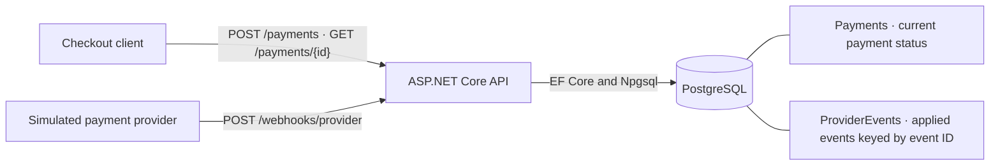
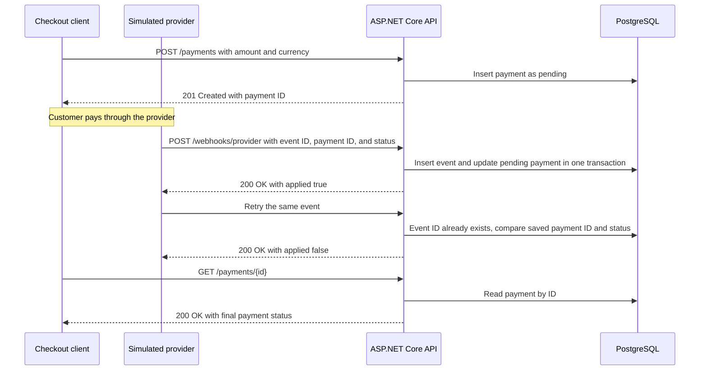

# Payment Reconciliation API

The API records simulated payments in PostgreSQL using ASP.NET Core and EF Core. New records start in the pending state.

## System design

In a checkout, a food delivery app such as Chowdeck would call the API before the customer pays. A payment provider such as Paystack would then report the outcome. In this demo, `curl` plays both roles and PostgreSQL stores the results.



### Payment lifecycle



### Webhook decisions

| Condition | Response |
| --- | --- |
| Valid new event for a pending payment | `200 OK` with `{"applied":true}`. The payment moves to `succeeded` or `failed`. |
| Same event ID, payment ID, and status | `200 OK` with `{"applied":false}`. The payment is untouched. |
| Event ID reused with a different payment ID or status | `409 Conflict` |
| New event for a payment with a final status | `409 Conflict` |
| Unknown payment ID | `404 Not Found` |
| Invalid event ID, payment ID, or status | `400 Bad Request` |

PostgreSQL enforces uniqueness on the event ID, including when two deliveries arrive concurrently. The event insert and status update commit together. If the payment is missing or already final, the API rolls back the insert so the rejected event never appears in the table of applied events. See [the endpoint implementation](Program.cs) and [the integration tests](tests/webhook_integration.py).

The webhook accepts simulated events for local development. A live provider integration would need signature verification and a mapping from the provider's payment reference to the internal payment ID. Settlement reports are outside this demo's payment-status workflow.


## Run locally

Install the .NET 10 SDK. Start a dedicated development database with Docker:

```sh
docker run --rm --name reconciliation-postgres \
  -e POSTGRES_PASSWORD=local-development \
  -e POSTGRES_DB=payments \
  -p 127.0.0.1:5433:5432 -d postgres:17
```

Once PostgreSQL is ready, run the API. It creates its schema on startup in the development database.

```sh
export ConnectionStrings__Payments='Host=localhost;Port=5433;Database=payments;Username=postgres;Password=local-development'
dotnet run --urls http://localhost:5080
```

## Try the endpoints

Amounts use the smallest unit of the currency. For example, 2500 NGN minor units are ₦25.00.

```sh
curl -i http://localhost:5080/payments \
  -H 'Content-Type: application/json' \
  -d '{"amountMinor":2500,"currency":"NGN"}'
```

Expect HTTP 201 and a Location header. Use the returned ID to read the saved record.

```sh
curl -i 'http://localhost:5080/payments/<payment-id>'
```

## Simulate a payment provider webhook

Send a new event ID and the ID of a pending payment. This endpoint is for local simulation.

```sh
curl -i http://localhost:5080/webhooks/provider \
  -H 'Content-Type: application/json' \
  -d '{"eventId":"demo-001","paymentId":"REPLACE_WITH_PAYMENT_ID","status":"succeeded"}'
```

The first delivery returns `200 OK` with `{"applied":true}`. Send the same payload again to get
`{"applied":false}`, then fetch the payment to confirm its status. Use a fresh event ID for each new
event. Supported final statuses are `succeeded` and `failed`. A changed payload under an existing
event ID or a new event targeting a finalised payment returns `409 Conflict`.

## Run integration tests

With the API and a development PostgreSQL database running, use Python 3 to run the HTTP tests.
The tests create their own simulated payment records.

```sh
python3 tests/webhook_integration.py
```
